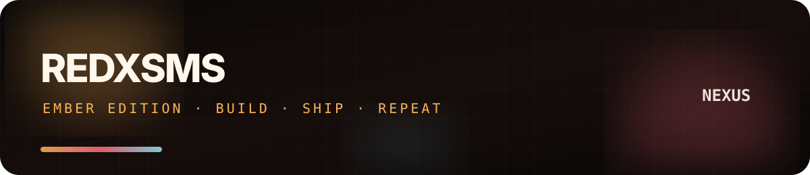
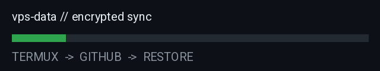

<div align="center">



# redxsms

**Developer · Builder · Automation tinkerer**

Ember-toned systems, encrypted workflows, and clean developer experiences.

[](https://github.com/redxsms/free-vps)
[](https://github.com/redxsms/free-vps)
[](https://github.com/redxsms/free-vps)
[](https://redxsms.github.io/free-vps/)

</div>

## Now

<table>
  <tr>
    <td width="50%" valign="top">
      <b>Building</b><br>
      <a href="https://github.com/redxsms/free-vps">free-vps</a> — a public showcase with Ember/Frost themes, live clock, security flow and roadmap.
    </td>
    <td width="50%" valign="top">
      <b>Shipping</b><br>
      <a href="https://redxsms.github.io/free-vps/">Live site</a> — Pages build is active and the theme preference is saved locally.
    </td>
  </tr>
  <tr>
    <td valign="top">
      <b>Private</b><br>
      <code>vps-data</code> — encrypted backup, restore and key-only SSH flow. No secrets are exposed publicly.
    </td>
    <td valign="top">
      <b>Focus</b><br>
      Termux workflows, automation, clean UI, and developer tooling that feels fast.
    </td>
  </tr>
</table>

## Featured

| Project | What it does |
|---|---|
| [free-vps](https://github.com/redxsms/free-vps) | Theme-aware landing page with particles, glass cards, scroll progress and terminal motion. |
| [NEXUS site](https://redxsms.github.io/free-vps/) | Public live demo with Ember and Frost modes. |
| `vps-data` | Private repo for encrypted snapshots, autosave, restore and SSH allowlisting. |
| `vps-data-kit` | Local toolkit: sync, restore, daemon, cron, clone and one-line connect helper. |

## Signal

<div align="center">
  
</div>

## Motion

<div align="center">
  
</div>

## Design system

| Token | Value | Use |
|---|---|---|
| Ember | `#FFB457` | Primary accent and highlights |
| Rose | `#FF6B81` | Secondary accent and status |
| Ice | `#8BE9FD` | Tertiary accent and links |
| Mint | `#9BFFB2` | Success and verified states |
| Base | `#0A0807` | Dark background |

## Stack

<div align="center">


</div>

## Connect helper

```bash
bash ~/vps-data-kit/connect.sh
```

The helper pulls the live session file, picks the correct identity key, and opens the shell without exposing a long command.

## Avatar source

The premium avatar source is available here: [avatar.png](assets/avatar.png). GitHub profile pictures must be uploaded from account settings; the API cannot set an avatar directly.

## Contact

Open an issue on [free-vps](https://github.com/redxsms/free-vps/issues) for feedback or collaboration.
