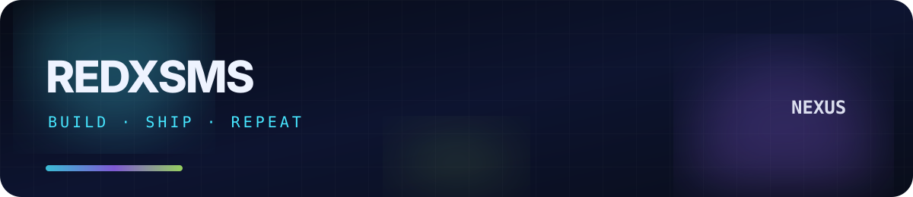

<div align="center">



# redxsms

**Developer · Builder · Automation tinkerer**

Card-free tooling, encrypted workflows, and clean developer experiences.

[](https://github.com/redxsms/free-vps)
[](https://github.com/redxsms/free-vps)
[](https://github.com/redxsms/free-vps)
[](https://github.com/redxsms/free-vps)

</div>

## Now

<table>
  <tr>
    <td width="50%" valign="top">
      <b>Building</b><br>
      <a href="https://github.com/redxsms/free-vps">free-vps</a> — a premium public showcase for a GitHub-powered 6-hour terminal.
    </td>
    <td width="50%" valign="top">
      <b>Private</b><br>
      <code>vps-data</code> — encrypted backup, restore and key-only SSH flow. No secrets are exposed publicly.
    </td>
  </tr>
  <tr>
    <td valign="top">
      <b>Focus</b><br>
      Termux workflows, automation, clean UI, and developer tooling that feels fast.
    </td>
    <td valign="top">
      <b>Rule</b><br>
      Short, legitimate sessions. Persistent data stays encrypted and separate.
    </td>
  </tr>
</table>

## Featured

| Project | What it does |
|---|---|
| [free-vps](https://github.com/redxsms/free-vps) | Public landing page with animated gradients, particles, glass cards and terminal motion. |
| `vps-data` | Private repo for encrypted snapshots, autosave, restore and SSH allowlisting. |
| `vps-data-kit` | Local toolkit: sync, restore, daemon, cron, clone and one-line connect helper. |

## Motion

<div align="center">
  
</div>

## Stack

<div align="center">


</div>

## Connect helper

```bash
bash ~/vps-data-kit/connect.sh
```

The helper pulls the live session file, picks the correct identity key, and opens the shell without exposing a long command.

## Contact

Open an issue on [free-vps](https://github.com/redxsms/free-vps/issues) for feedback or collaboration.
