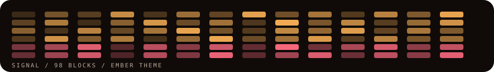

<div align="center">


# redxsms

**Developer · Builder · Automation tinkerer**

Ember-toned systems, encrypted workflows, and clean developer experiences.


</div>

## Now

<table>
  <tr>
    <td width="50%" valign="top">
      <b>Building</b><br>
      <code>vps-data</code> — private encrypted backup, restore and key-only SSH flow.
    </td>
    <td width="50%" valign="top">
      <b>Running</b><br>
      Windows-based GitHub Actions sessions with six-hour limits and autosave.
    </td>
  </tr>
  <tr>
    <td valign="top">
      <b>Focus</b><br>
      Termux workflows, automation, clean UI, and developer tooling that feels fast.
    </td>
    <td valign="top">
      <b>Rule</b><br>
      Short, legitimate sessions. Persistent data stays encrypted and separate.
    </td>
  </tr>
</table>

## Workspace

| Piece | What it does |
|---|---|
| `vps-data` | Private repo for encrypted snapshots, autosave, restore and SSH allowlisting. |
| `vps-data-kit` | Local toolkit: sync, restore, daemon, cron, clone and one-line connect helper. |
| Windows runner | GitHub-hosted `windows-latest` shell for builds, tests and short experiments. |
| Ember profile | Animated banner, signal grid and premium visual system hosted in this repo. |

## Signal

<div align="center">
  
</div>

## Motion

<div align="center">
  
</div>

## Design system

| Token | Value | Use |
|---|---|---|
| Ember | `#FFB457` | Primary accent and highlights |
| Rose | `#FF6B81` | Secondary accent and status |
| Ice | `#8BE9FD` | Tertiary accent and links |
| Mint | `#9BFFB2` | Success and verified states |
| Base | `#0A0807` | Dark background |

## Stack

<div align="center">


</div>

## Connect helper

```bash
bash ~/vps-data-kit/connect.sh
```

The helper pulls the live session file, picks the correct identity key, and opens the shell without exposing a long command.

## Avatar source

The premium avatar source is available here: [avatar.png](assets/avatar.png). GitHub profile pictures must be uploaded from account settings; the API cannot set an avatar directly.

## Contact

Open an issue on [this profile repo](https://github.com/redxsms/redxsms/issues) for feedback or collaboration.
